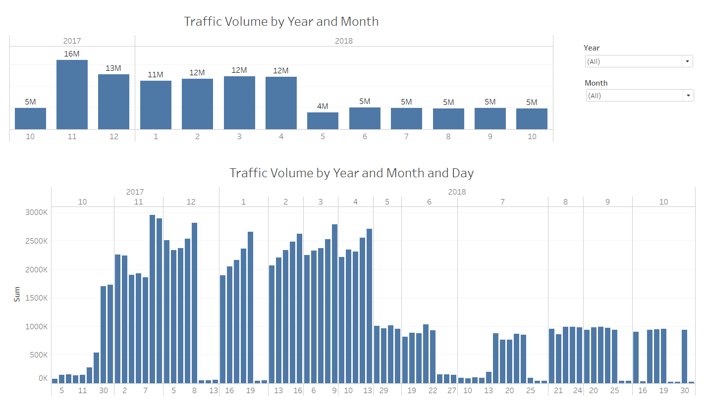
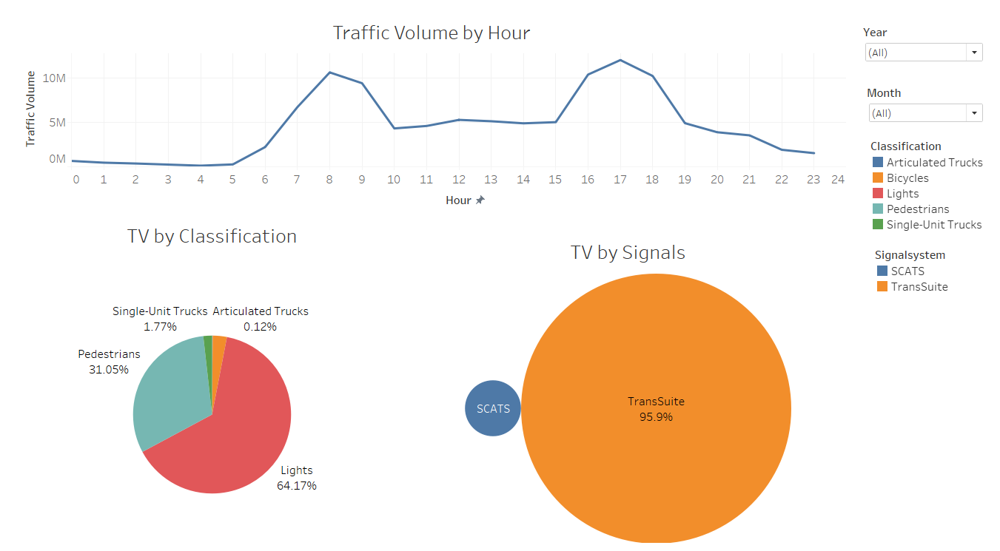
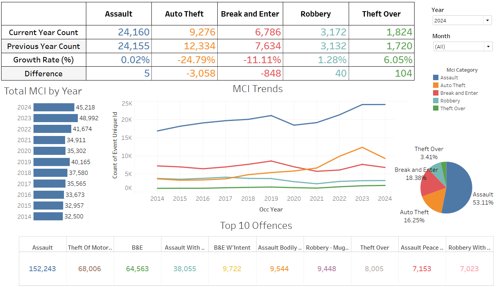
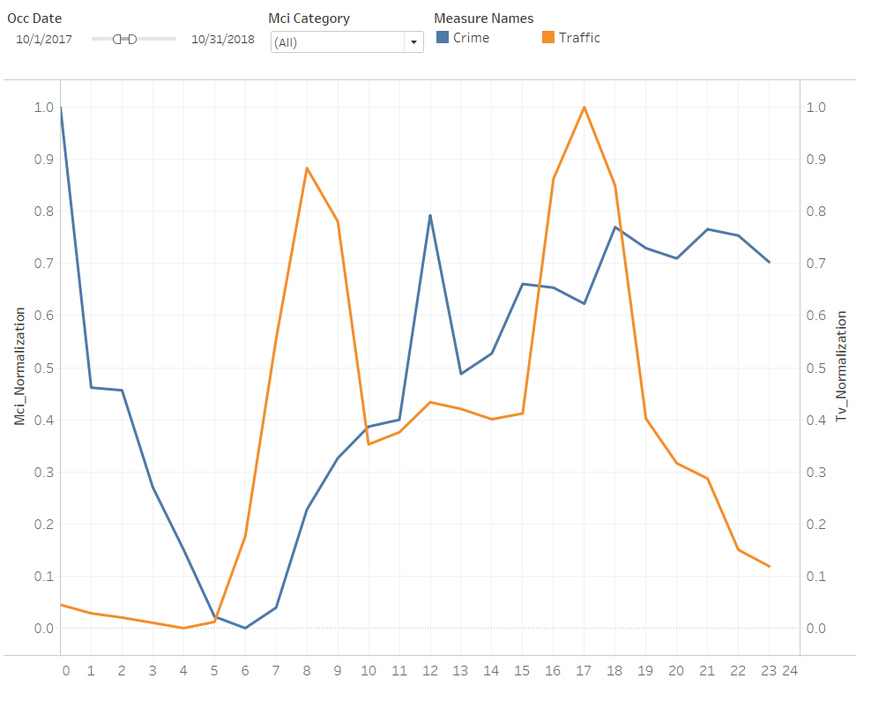
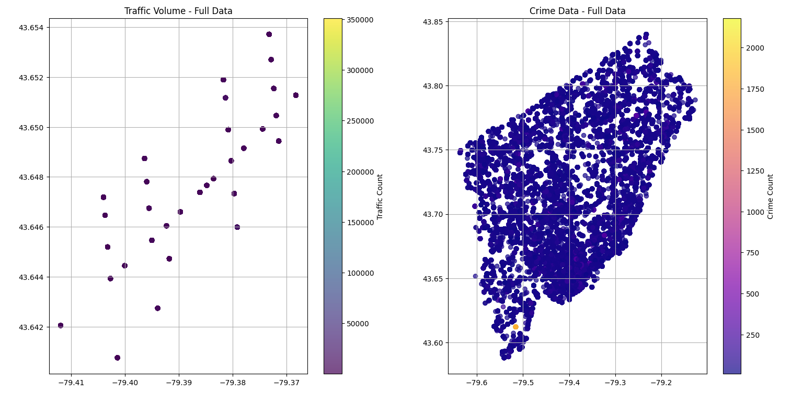
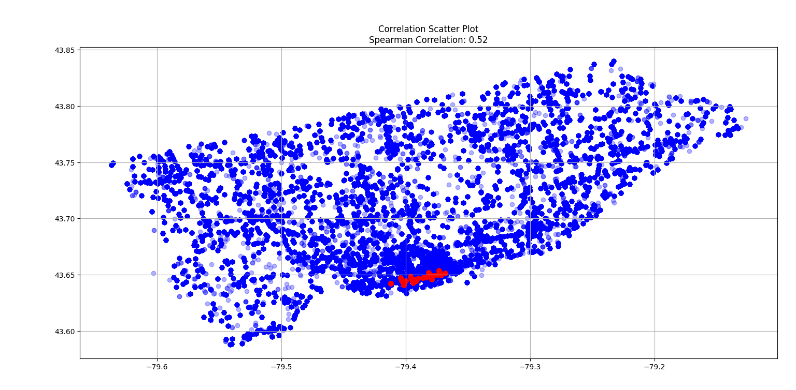
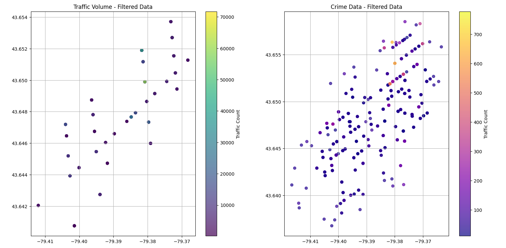
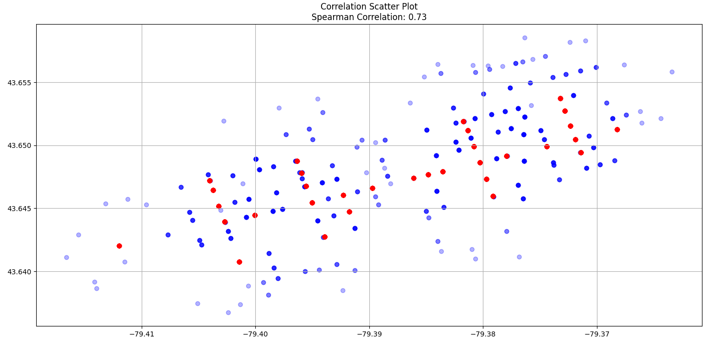

# Toronto Traffic & Crime Analysis

An analysis of City of Toronto open data that explores traffic patterns on King Street, major crime trends across the city, and the relationship between traffic volume and crime.

**Tools:** SQL Server · Tableau · Python · CSV
**Author:** Faezeh Karam Zadehshiri, Data Analyst · March 2025

## Objective

Support traffic management and crime prevention by finding patterns in traffic and crime data and measuring how the two are related.

## Data

| Dataset | Coverage | Source |
|---|---|---|
| Traffic volume | King Street, Oct 2017 to Oct 2018 | [City of Toronto Open Data](https://open.toronto.ca/catalogue/) |
| Major Crime Indicators (MCI) | City of Toronto, 2014 to 2024 | [Toronto Police Service Public Safety Data Portal](https://data.torontopolice.on.ca/pages/major-crime-indicators) |

## Process

1. **Data collection:** downloaded traffic and crime data as CSV files from the open data portals.
2. **Cleaning and transformation (SQL Server):** filtered invalid records, detected outliers and normalized values (Min-Max normalization) so traffic and crime could be compared on the same 0 to 1 scale.
3. **Dashboard design (Tableau and Python):** built interactive dashboards with filters for year, month and classification.
4. **Analysis:** identified trends, patterns and correlations between traffic and crime.
5. **Testing:** checked the dashboards for accuracy, clarity and ease of use.

## Dashboards

### Traffic volume

### Major crime

### Traffic and crime correlation by hour

### Traffic and crime correlation by location
Citywide data (Spearman correlation 0.52):

Crime records within 0.005 degrees of King Street (Spearman correlation 0.73):

## Key findings

**Traffic**
- Peak traffic hours are 7 to 9 AM and 4 to 7 PM.
- Light vehicles make up 64.17% of traffic volume and pedestrians 31.05%.
- The TransSuite system controls most traffic signals.
- The sharp drop between April and May 2018 is most likely caused by missing days in the data, not a real change in traffic.

**Crime**
- Major crime incidents rose gradually from 2014 to 2024, peaking in 2024 (45,218 incidents).
- Assault is the most common category (53.11%), followed by Break and Enter (18.38%) and Auto Theft (16.25%).
- Auto Theft fell 24.79% in 2024 compared with 2023, while Robbery and Theft Over rose slightly.

**Traffic and crime**
- By hour: a strong inverse relationship appears from late night to early morning, the link is weaker at midday, and crime rises slightly during evening peak traffic.
- By location: the Spearman correlation is 0.52 citywide and rises to 0.73 when the analysis focuses on areas near King Street, so busier areas show a stronger link between traffic and crime.

## Recommendations

- Strengthen security measures in high-traffic areas.
- Deploy security resources during peak traffic hours and in high-crime areas to improve resource management and public safety.

## Files

- `Toronto_Traffic_Crime_Analysis.pptx`: full project presentation
- `images/`: dashboard screenshots
